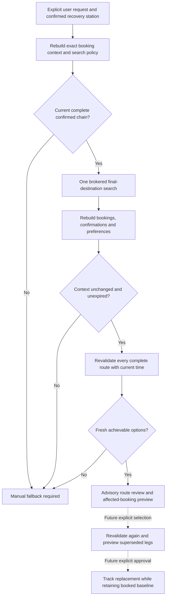

# Recovery review controller (development only)

Updated: 6 November 2026. Internal orchestration is implemented and tested.
Home Assistant commands, dashboard controls, adoption and tracking are pending.
Nothing in this guide enables a live recovery search automatically.

## Intended flow and implemented boundaries

`RecoveryReviewController` implements B through H and an internal result for I.
The surrounding user commands and rendered screens are still required. Search
acquisition uses [the recovery route contract](RECOVERY_ROUTE_CONTRACT.md).

## State and ownership

The controller is scoped to one integration runtime. Its initial state is
`not_requested`. A dashboard read cannot trigger acquisition. Only a future
explicit command may call `async_review`; ordinary coordinator refreshes must not.
A second command during acquisition returns `search_in_progress` without
starting another query. Search parameters come from an immutable policy snapshot:
evidence age, initial wait, total duration, resolved transfer preferences and
global fallback. The Railinfo boundary still supports at most one change.

The inputs callback rebuilds the context from current calendar intent, exact
confirmations and preferences without provider I/O. Keep the original user-origin
confirmation timestamp unchanged; rebuilding is not a new location confirmation.
Read inputs before acquisition and again after it returns, including unsuccessful
searches. A changed scope or policy discards results. Revocation or unloading can
also call `invalidate`, preventing an in-flight result from restoring old options.

Before exposure, validate every route again against the complete final destination,
current time and captured policy. Do not mix routes from another journey, retain
only a partial route, or expose unrecognized provider status text. Successful
results remain advisory and preserve unknown ticket acceptance. No selection,
calendar edit, booking mutation, announcement or adopted tracking is performed.

The context includes the entire original connected booking baseline and the
separate affected booking IDs. These are a future supersession preview; they do
not mark anything superseded. A replacement must still be explicitly chosen and
approved after a fresh whole-route check.

## Expiry, errors and manual fallback

`current()` rechecks context and policy, then removes expired options. It never
refreshes evidence or queries a provider. Expired options require a new explicit
review. Results are memory-only; restart begins with no reviewed options.

Unavailable, stale, incomplete and unsupported results carry
`manual_fallback=True`. The future UI must explain the specific outcome and offer
an actionable fallback, such as opening live departure information or consulting
station staff for onward travel. A no-complete-route response means no candidate
validated in that response; it does not establish that no route exists.

Timeouts and expected input/acquisition failures clear the review. Task
cancellation releases the in-flight guard and clears the searching state; it
cannot replay a previous successful result. Unexpected exceptions still propagate
for diagnosis, while cleanup clears the searching state. Unknown provider status
text is replaced with a stable invalid-response category.

## Validation and next steps

23 focused cases cover explicit-only acquisition, concurrent requests, revocation,
booking and preference changes during a query, unload, expiry during acquisition
and later reads, wrong-journey results, old predictions, provider outcomes, failed
and cancelled commands, and invalid policies. The full local suite passes with
731 tests and one existing expected failure; the restricted local TCP-serving
test was deselected. These are software checks, not real-travel acceptance.

Next: add a Home Assistant command that constructs current context safely, wire
this controller into runtime lifecycle cleanup, expose full options and manual
fallback on the dashboard, then implement selection revalidation and explicit
adoption. Provider-confirmed cancellation/early-termination origins need their
own matched evidence adapter. Routes with more than one change remain a provider
capability gap.
