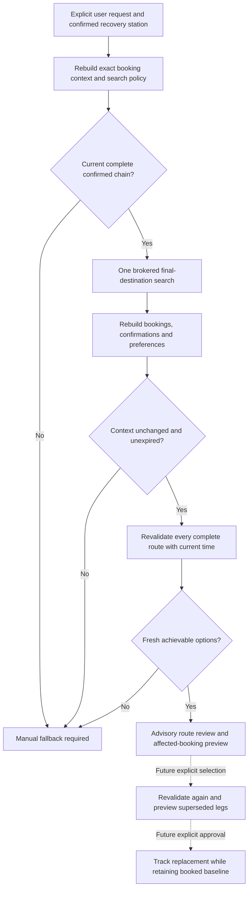

# Recovery route review (development only)

Updated 7 November 2026. The development branch includes the Home Assistant
action and dashboard form for explicit Railinfo recovery review. Route selection,
adoption and continued tracking are later milestones.

1. Confirm each intended connection between separate rail calendar bookings.
2. With Railinfo selected and a current calendar review, open **Find another
   route** on the Journey Guardian card.
3. Choose the affected train and the final booked train in the connected journey.
   Enter the station name you can leave from now.
4. Select **Confirm station and find routes**. Review the predicted times,
   transfer allowance, expiry and affected bookings. Ticket acceptance is unknown.
5. If the search cannot verify a complete route, check live departures or ask
   station staff about onward travel.

The equivalent Home Assistant action is `journey_guardian.review_recovery`.
It accepts `affected_booking_id`, `final_booking_id` and `origin` and returns a
status. The status sensor publishes the advisory result in its live `recovery`
attribute, which is excluded from Recorder. The card displays the live attribute.

This first version treats the traveller as ready at the named station when
they submit the action. It uses a maximum two-hour wait, eight-hour route
duration, five-minute evidence age and a calendar review at most 15 minutes old.
Only same-day direct or one-change Railinfo routes are supported. Affected
bookings must still be present in the current calendar response. Station names
and saved station defaults resolve through the existing station resolver before
one route query. An unresolved station or conflicting defaults stops the review.

## Intended flow and implemented boundaries

`RecoveryReviewController` implements B through H and an internal result for I.
The Home Assistant action and card implement A and I. Search acquisition follows
[the recovery route contract](RECOVERY_ROUTE_CONTRACT.md).

## State and ownership

The controller is scoped to one integration runtime. Its initial state is
`not_requested`. A dashboard read cannot trigger acquisition. Only the explicit recovery action calls `async_review`.
A second command during acquisition returns `search_in_progress` without
starting another query. Search parameters come from an immutable policy snapshot:
evidence age, initial wait, total duration, resolved transfer preferences and
global fallback. The Railinfo boundary still supports at most one change.

The inputs callback rebuilds the context from current calendar intent, exact
confirmations and preferences without provider I/O. Keep the original user-origin
confirmation timestamp unchanged; rebuilding is not a new location confirmation.
Read inputs before acquisition and again after it returns, including unsuccessful
searches. A changed scope or policy discards results. Revocation or unloading can
also call `invalidate`, preventing an in-flight result from restoring old options.

Before exposure, validate every route again against the complete final destination,
current time and captured policy. Do not mix routes from another journey, retain
only a partial route, or expose unrecognized provider status text. Successful
results remain advisory and preserve unknown ticket acceptance. No selection,
calendar edit, booking mutation, announcement or adopted tracking is performed.

The context includes the entire original connected booking baseline and the
separate affected booking IDs. These are a future supersession preview; they do
not mark anything superseded. A replacement must still be explicitly chosen and
approved after a fresh whole-route check.

## Expiry, errors and manual fallback

`current()` rechecks context and policy, then removes expired options. It never
refreshes evidence or queries a provider. Expired options require a new explicit
review. Results are memory-only; restart begins with no reviewed options.

Unavailable, stale, incomplete and unsupported results carry
`manual_fallback=True`. The card explains the outcome and points to live departures or station staff. A no-complete-route response means no candidate
validated in that response; it does not establish that no route exists.

Timeouts and expected input/acquisition failures clear the review. Task
cancellation releases the in-flight guard and clears the searching state; it
cannot replay a previous successful result. Unexpected exceptions still propagate
for diagnosis, while cleanup clears the searching state. Unknown provider status
text is replaced with a stable invalid-response category.

## Validation and next steps

The local suite passed 735 tests with one existing expected failure, including
the local TCP frontend-serving test. Nine card tests passed. The fictional browser
preview verified the form, final destination and affected-leg display, and the
fallback at phone width. Live travel acceptance remains pending.

Selection revalidation, explicit adoption and tracking are the next milestone.
Provider-confirmed cancellation and early termination need a matched evidence
adapter. Routes with more than one change remain a provider capability gap.
